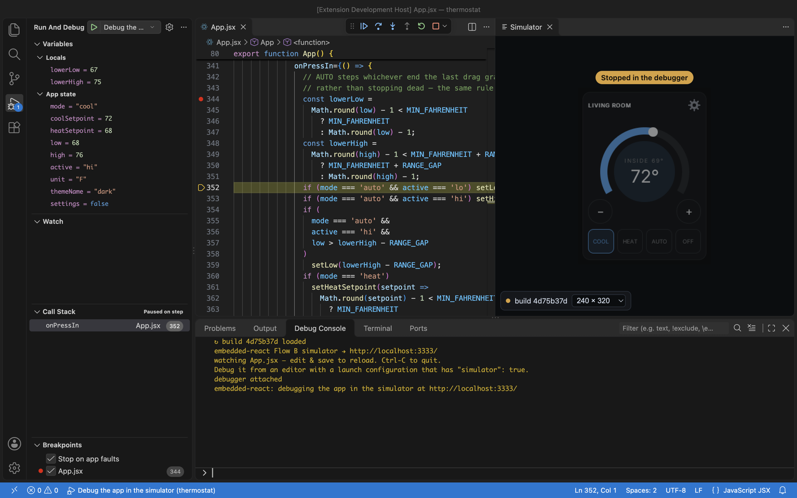

# Embedded React for VS Code

Debugs a Flow B app from the editor, on a board or in the simulator with no board: breakpoints in the gutter of the
app's source, the step buttons, the app's frames in the call stack, and its state and locals in the Variables pane.
An app fault stops on the line that faulted, with its reason. On a board, C breakpoints and stepping work in the same
session.



## Install

Search for "Embedded React" in the Extensions view, or:

```bash
code --install-extension embedded-react.embedded-react-debug
```

It is on the Visual Studio Marketplace and on Open VSX, and each release has the `.vsix` attached.

The extension only registers the `embedded-react` debug type. The debug adapter is in the project's `embedded-react`
package (`embedded-react debug-adapter`), so it always matches the compiler that wrote `app.erdbg`. When the project's package is too old to have one, the session's error says so.

## In the simulator

A project with `embedded-react` installed is all it needs. Add this configuration to `.vscode/launch.json` (the snippet
"Embedded React: simulator" fills it in) and start it:

```json
{
  "type": "embedded-react",
  "request": "launch",
  "name": "Debug the app in the simulator",
  "simulator": true,
  "cwd": "${workspaceFolder}"
}
```

It starts the Flow B simulator (`embedded-react dev --aot`), shows it in a split to the right of the code, and ends it with the session. A
save reloads the app and keeps the breakpoints. The `embedded-react.openSimulator` setting opens the simulator in a
browser instead, or leaves it closed. "Embedded React: attach to the simulator" debugs one that already runs.

## On a board

- A project with `embedded-react` installed, and an app built with `embedded-react build --aot`.
- Firmware built with `ERB_DEBUG_HOOK=1`, for breakpoints and stepping in the app and the stop at a fault.
- GDB 14 or later for the board, built with Python. The session's error says when the GDB isn't, and what to use.
- A GDB server for the probe, such as OpenOCD.

The ESP32-S3 and RP2040 board examples have a `.vscode` folder that builds, flashes and attaches on F5, and
`npm create embedded-react@latest my-app -- --board <name>` writes one for a new project.

To write one by hand, add a configuration to `.vscode/launch.json`, then start it. **Add Configuration** has a snippet
for each board family:

- "Embedded React: STM32 with an ST-Link"
- "Embedded React: STM32H7 with two flash banks"
- "Embedded React: ESP32-S3 built-in JTAG"
- "Embedded React: RP2040 with a debug probe"

The STM32 one fills in this:

```json
{
  "type": "embedded-react",
  "request": "attach",
  "name": "Debug the app on the board",
  "program": "${workspaceFolder}/build/firmware.elf",
  "debugFile": "${workspaceFolder}/dist/app.erdbg",
  "gdb": "arm-none-eabi-gdb",
  "server": [
    "openocd",
    "-f",
    "interface/stlink.cfg",
    "-f",
    "target/stm32f7x.cfg"
  ],
  "serverReady": "Listening on port 3333 for gdb connections",
  "target": "localhost:3333",
  "disconnectCommands": ["monitor resume"]
}
```

A configuration's `"cli"` names the `embedded-react` CLI to run the adapter from, when it isn't the one in the
project's `node_modules`. A debug file that isn't the one of the app on the board ends the session with a message
that says so.

[Debugging on a board](https://embedded-react.dev/guides/debugging#from-an-editor) has a configuration for each board
family, and [The debug adapter](https://embedded-react.dev/internals/flow-b-packages#the-debug-adapter) describes each
field.

## Build

```bash
npm install
npm run build
```

`npm run package` writes a `.vsix` to install with "Extensions: Install from VSIX". The release workflow publishes
the same file, at the repository's version.
